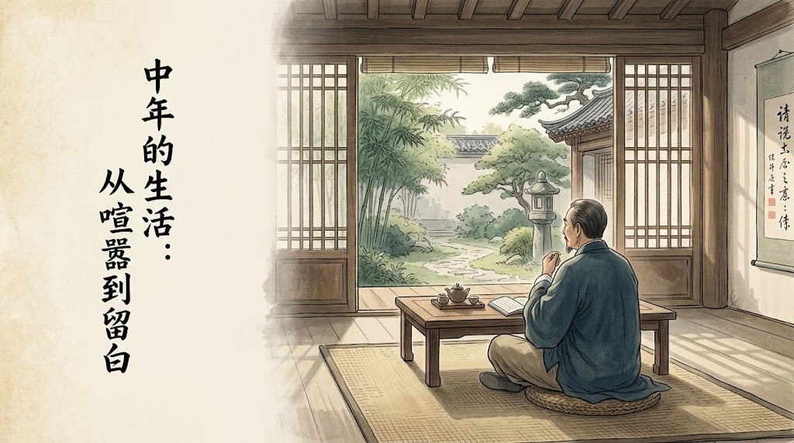

+++
title = "人到中年，最舒服的活法：不迎合，不解释，不凑热闹"
date = "2026-10-14T20:38:22+02:00"
categories = ["自省集"]
tags = []
draft = false
+++

年轻的时候，我总觉得生活应该热闹一点。

朋友越多越好，聚会越频繁越好，手机最好随时有人发来消息。周末若是没有安排，便觉得白白浪费了两天；一个人待在家里，总有一种被生活落在后面的感觉。

那时候，我们好像特别害怕冷清。

后来才发现，人这一生，有些东西真是奇怪。年轻时拼命往人群里挤，到了某一天，却开始怀念那些没有人打扰的下午。

周末睡到自然醒，慢慢煮一壶茶，窗外有人修剪树枝，偶尔传来几声鸟叫。手机放在桌上，一整个上午都没有什么重要消息。

这样的日子，年轻时会嫌无聊，如今却觉得难得。

难道是人变懒了？

恐怕不全是。

年轻时喜欢热闹，是因为我们还有太多东西要向外寻找。需要朋友的认可，需要别人的羡慕，需要在一场场聚会里确认自己过得不错。甚至有时候，明明已经累了，还是不愿意先离开，仿佛谁先回家，谁就输了这场看不见的比赛。

人情世故里有许多这样的小游戏。大家都知道没什么意思，却又都不愿意先退出。

到了中年，才渐渐发现，人生并没有观众席。

你买了什么车，换了什么工作，去了什么地方，别人也许会好奇几天。但日子终究是自己的。你深夜为房贷发愁，清晨拖着疲惫的身体起床，担心父母的身体，操心孩子的成长，这些事情，没有哪一场热闹能够替你承担。

别人的掌声当然很好，只是掌声散去以后，日子还是要自己过。

这时候，人开始懂得珍惜精力。

年轻时，我们总觉得时间很多，精力也很多。今天熬夜，明天补觉；这次不开心，下次再约。仿佛生活是一张可以无限续费的会员卡。

后来才知道，时间确实会过去，精力却不会一直回来。

有些饭局，去不去都不会改变什么；有些关系，维持得再热闹，也未必有多少真心；有些话，解释一百遍，对方还是只愿意相信自己想相信的那一部分。

既然如此，何必把每一件事都当成必须完成的任务？

当然，中年人的清静，也不全是看透了人生。

有时候只是累了。

工作已经够忙，生活已经够重，回到家里，只想安安静静地坐一会儿。不是不喜欢朋友，而是不想再把仅剩的一点精力，用来维持那些其实并不亲近的关系。

年轻时，我们害怕别人不喜欢自己。

后来才慢慢明白，一个人不可能让所有人满意。你热情一点，有人觉得你有所企图；你沉默一点，有人觉得你不近人情；你愿意帮忙，有人把它当成理所当然；你偶尔拒绝一次，反倒成了不够朋友。

人的评价，有时候就像天气。你不能因为明天可能下雨，就不再出门。

于是，我们终于学会了一件事：不再把每个人的看法，都当成自己的责任。

这不是冷漠，而是开始分清什么值得在意，什么可以随它去。

不过，我也不愿意把中年人的安静，说成一种多么高明的境界。

有些人确实越来越从容，有些人只是被生活磨得没了兴致；有些人享受独处，有些人其实很孤独，只是不知道该找谁说话。

这两者看起来很像，心里却完全不同。

真正舒服的状态，大概不是拒绝热闹，也不是勉强自己合群，而是既能和朋友推杯换盏，也能一个人吃饭散步；既能在人群里谈笑风生，也能在没有消息的日子里安然度过。

热闹的时候，不必故作清高；清静的时候，也不必怀疑自己是不是越来越不合群。

毕竟，人这一生，既需要有人同行，也需要有一段路，只听得见自己的脚步声。

前几天，我忽然觉得，人的一生其实很像一间房子。

年轻时，总想把房间装满。家具要多，朋友要多，行程要满，最好每个角落都有声音。生怕留下一块空地，就显得生活不够充实。

后来才知道，房间里真正让人舒服的地方，往往不是摆满东西的角落，而是那扇能够透进阳光的窗。

窗前不必放太多东西。

偶尔有风吹进来，有树影落在地板上，有人从远处经过。你坐在那里，什么也不做，也不觉得亏欠了谁。

人到中年，或许就是慢慢学会给生活留白。

不是不再喜欢这个世界，而是不必每时每刻都向世界证明，自己正在认真地活着。

如果有一天，你发现自己越来越喜欢安静，不必急着把它当成衰老的征兆。

也许只是走了很远的路以后，你终于不再需要一路敲锣打鼓，来确认自己没有掉队。

你知道自己要去哪里。

即使暂时不知道，也允许自己停下来，看一会儿窗外的树。

