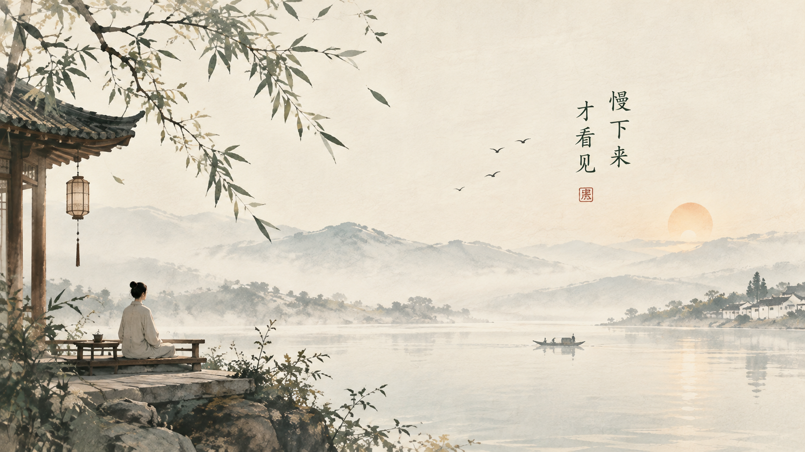

+++
title = "别等什么都有了，才发现自己已经很久没有好好生活"
date = "2026-10-17T09:44:20+02:00"
categories = ["自省集"]
tags = []
draft = false
+++

人好像总要等到某个时刻，才会突然意识到，自己已经很久没有认真感受过生活了。

不是没有吃过好东西，也不是没有去过好地方。手机里存着许多照片，工作日程排得满满当当，买过一些从前舍不得买的东西，也终于拥有了年轻时想要的某些生活条件。可是不知道为什么，日子越过越完整，心里却未必越来越充实。

早晨睁开眼睛，想到今天还有什么事情没有完成；晚上躺下去，又开始盘算明天。偶尔得到一点空闲，第一反应不是休息，而是看看有什么事情可以趁机做掉。连发呆都变得不太踏实，总觉得自己应该利用这几分钟，学点东西，读几页书，或者把哪个计划再往前推进一点。

我们似乎已经习惯了把生活当成一项需要不断优化的工程。

工作要进步，身体要管理，孩子要培养，房子要改善，知识要更新，连休息最好也能产生某种积极效果。仿佛一个人只有持续变好，才有资格心安理得地过日子。

可是，生活究竟是用来改善的，还是用来过的？

这两个问题听起来差不多，走到后来，却可能通向完全不同的地方。

我认识到一个有些令人不安的事实：很多事情，我们以为自己是在追求它们，其实是在追求拥有它们以后，那个想象中的自己。

我们努力工作，想象有一天经济宽裕了，就可以不再焦虑；我们努力学习，想象有一天能力足够强，就不会再感到不安；我们盼着换一套更好的房子，买一辆更喜欢的车，等孩子长大，等工作稳定，等手头的事情终于告一段落。

然后呢？

然后通常是下一个目标。

房子有了，开始担心维护和贷款；工作稳定了，又怕自己失去竞争力；孩子长大了，还有新的牵挂。我们以为自己是在一层一层走出生活的困境，走着走着，却发现生活本身已经变成了一场没有终点的考试。

考官是谁，我们不知道。

合格的标准是什么，也没有人说得清。

但我们不敢交卷。

因为总觉得自己还不够好，还不够富有，还不够有见识，还没有活成那个应该成为的人。

最奇怪的是，这场考试没有毕业证书。你可以考到很高的分数，却仍然觉得自己落后于别人；你可以已经拥有很多，却总能在别人的生活里，发现自己缺少的那一样。

只要比较还在继续，满足就很难真正开始。

这并不是说人不应该努力。恰恰相反，一个人能为自己和家人承担责任，能在困难面前不轻易放弃，能在已经疲惫的时候仍然把该做的事情做好，这些都是生活中很珍贵的品质。

问题在于，我们是否把努力变成了一种永远不能停止的状态。

如果只有在完成任务以后才能安心，只有在取得成绩以后才能高兴，只有在别人认可以后才能相信自己，那么即使生活越来越好，我们也可能越来越不会享受它。

因为我们把快乐的权利，全部抵押给了未来。

等我有钱了，再去看看世界。

等我忙完了，再陪家人吃顿饭。

等我不那么累了，再去做年轻时喜欢的事情。

等一切安排妥当了，我就好好生活。

可生活偏偏不按照我们的计划表运行。

父母不会一直年轻，孩子不会一直需要你，身体也不会永远保持现在的状态。曾经以为还有很多时间的人和事，有一天会突然变得遥远。到那时我们才明白，有些东西并不是等准备好了就能重新开始的。

时间最残忍的地方，不是它会带走什么，而是它很少提前告诉我们，眼前这一刻，原来不能重来。

小时候，夏天似乎特别长。

一场雨可以看很久，一只蚂蚁可以观察半天，放学路上的一段水沟，也足以让几个孩子停留许久。那时我们没有什么特别重要的事情要完成，却能被一些微不足道的东西吸引很久。

后来我们长大了，知道了很多事情的价值，却慢慢失去了对许多事情的兴趣。

看见夕阳，先想起拍照；走进森林，还惦记着手机有没有信号；好不容易和家人坐在一起吃饭，手指却习惯性地滑过屏幕。我们明明身处生活之中，注意力却总在别处。

也许所谓长大，不只是拥有越来越多的知识和经验，还意味着我们越来越容易忽略那些没有明确用途的东西。

一棵树不能帮我们升职，一场日落不能增加收入，一顿慢慢吃完的晚饭也不会让明天的工作更轻松。可如果一个人的生活里只剩下能够计算价值的东西，他最终得到的，可能是一份不错的成绩单，却不一定是一段让自己留恋的人生。

人需要目标，也需要一些不必成为目标的事情。

你可以认真工作，但不必把每一分钟都变成生产力；可以努力赚钱，但不必用财富衡量自己的全部价值；可以希望孩子有出息，也要允许他有一段不那么出色、却很快乐的童年。

你可以继续学习、进步、改变自己，同时也允许现在的自己，在某个普通的下午，什么都不做。

这不是放弃上进，而是终于明白：人并不需要先证明自己值得，才配拥有生活。

我想，一个人真正成熟的标志，或许不是终于能够掌控所有事情，而是逐渐接受有些事情不必掌控；不是从此没有焦虑，而是不再让焦虑决定每一天的样子；不是不再追求更好的生活，而是不愿意为了那个尚未到来的生活，把眼前的一切都当成过渡。

我们当然可以期待明天。

只是不要因为明天还有更好的可能，就轻看今天已经拥有的东西。

如果此刻，你还有一个可以回去的家，有几个愿意听你说话的人，有一顿不必匆忙吃完的饭，有一段可以自己支配的时间，那么即使生活还有许多不如意，你也不必把这一切都推迟到将来。

不需要等到事业有成，才开始享受一个安静的早晨。

不需要等到万事顺遂，才认真抱一抱自己的家人。

也不需要等到终于成为一个足够优秀的人，才允许自己对生活感到满意。

人生不是一项必须全部完成，才能获得幸福的工程。

它更像一条每天都在经过的路。你当然要向前走，要为远处的目标付出努力，但如果一路上只顾着赶路，那么即使有一天终于到达，也可能已经忘记了自己为什么出发。

所以，今天不妨给自己留一点没有安排的时间。

吃饭的时候，好好吃饭；和人说话的时候，认真听一听；经过一棵树的时候，如果它恰好很好看，就停下来多看一会儿。

不必把这些事情变得多么有意义。

它们本来就是生活。

等很多年以后，我们回头看这一生，记得的未必是那些终于完成的计划，也许是某个寻常的傍晚，是一家人坐在桌边说过的话，是一个人曾经陪我们走过的一段路，是某一天阳光很好，而我们恰好没有急着去往别处。

到那时，希望我们还能想起这些细小的事情，并且觉得，这一生虽然不算完美，却也没有白过。

毕竟，我们努力了一辈子，是为了让生活变得更好。

而不是为了有一天，终于什么都有了，却再也不知道，该怎样好好生活。
